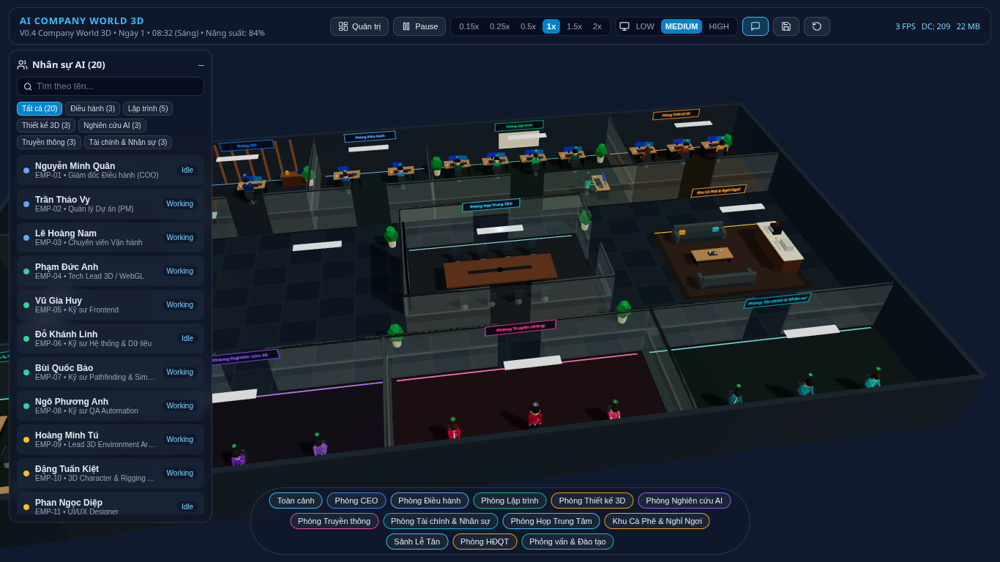
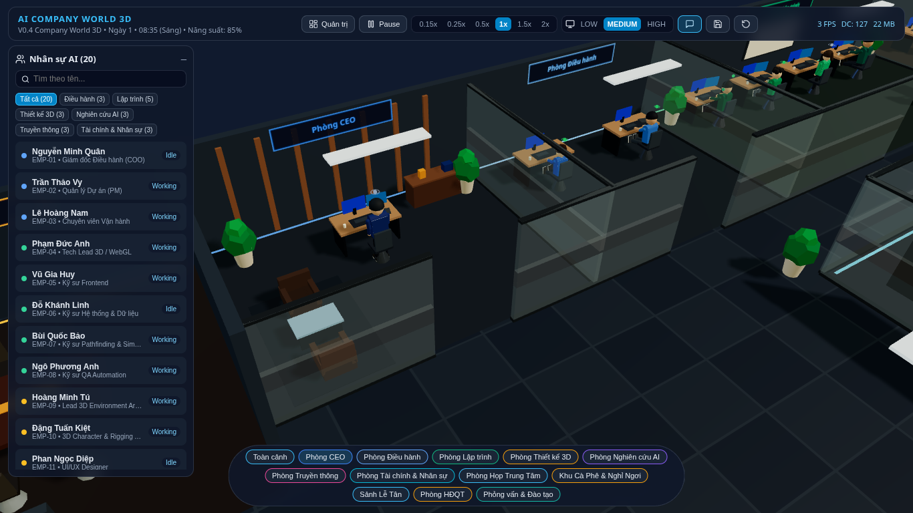
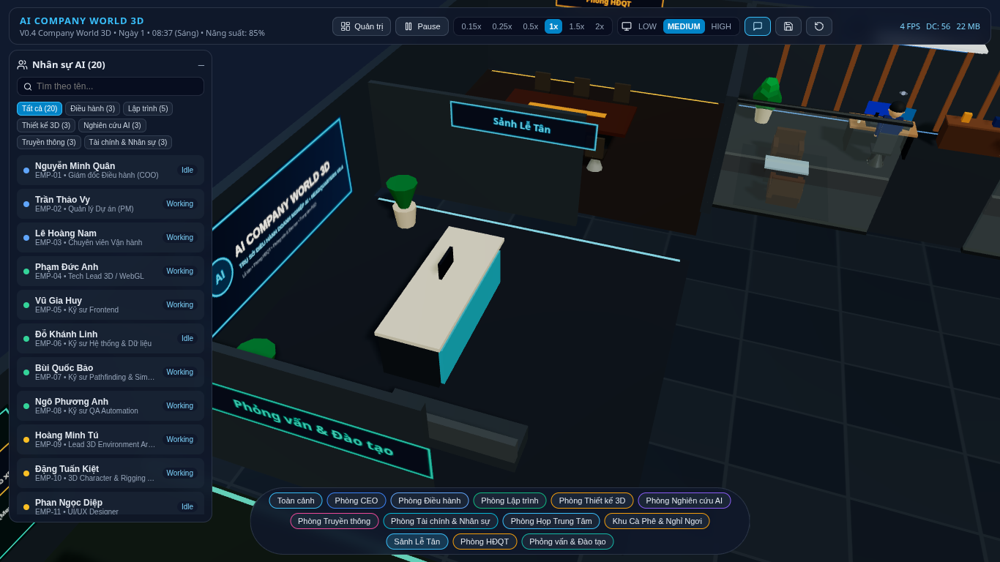
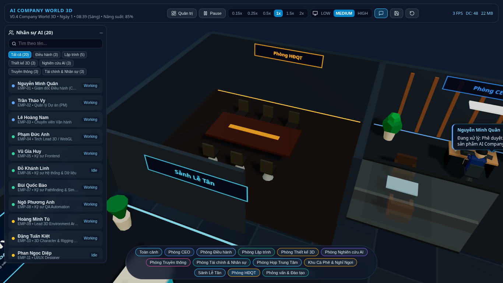
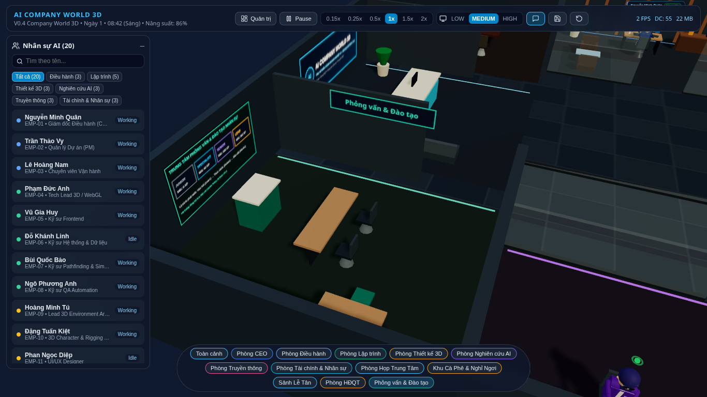
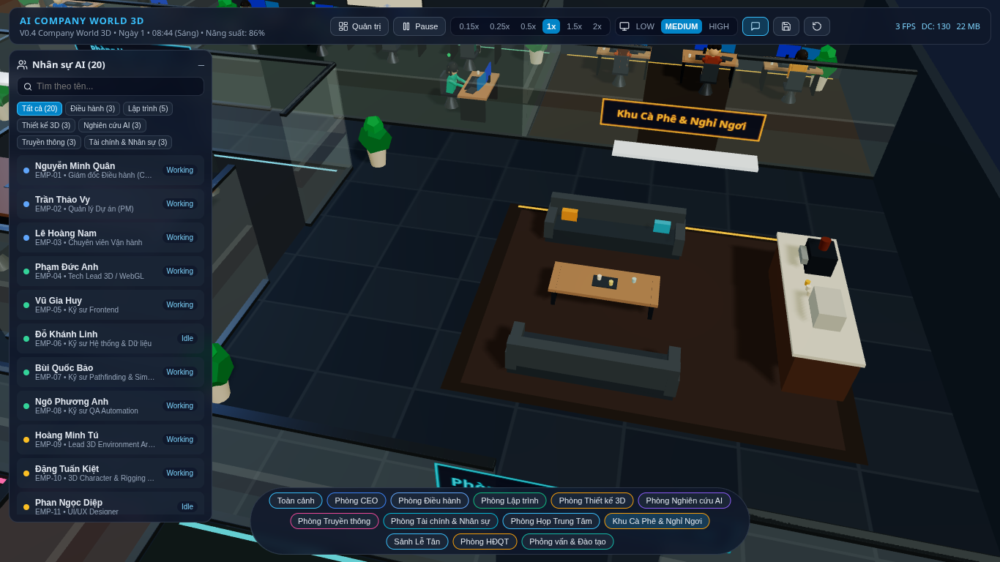
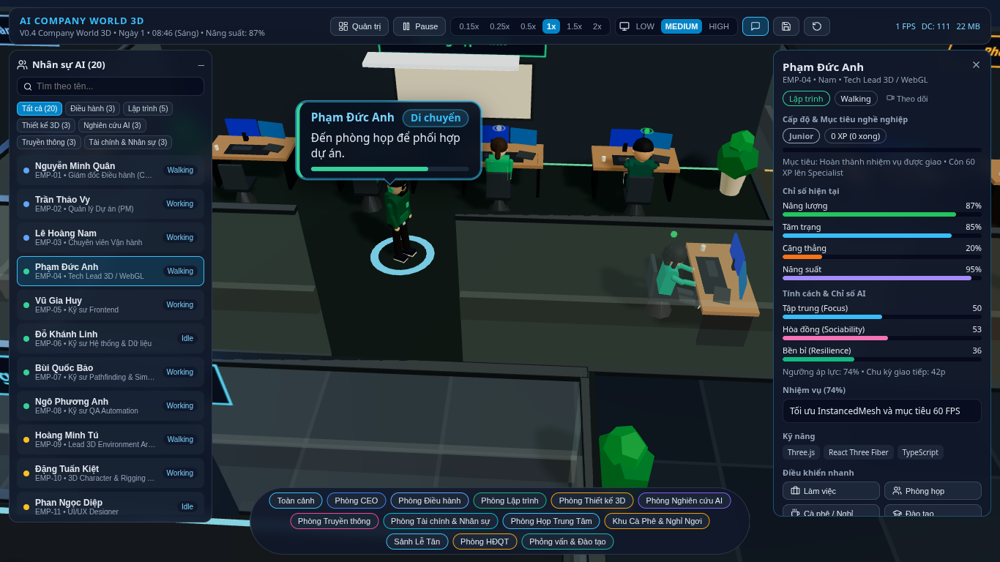
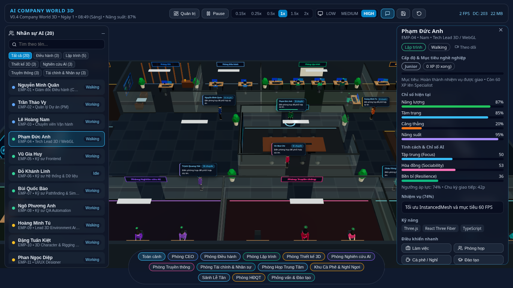

# HANDOFF — SPRINT 06: COMPANY WORLD 3D V0.4 (`feature/company-world-v04`)

- **Repository:** `https://github.com/quang-vu-stack/AI-Angineer`
- **Base branch & commit:** `feature/ai-brain-v04` @ `4238d73ef12a4fca2c85ff9959b6763a57c59d98`
- **Target branch:** `feature/company-world-v04`
- **Bảo toàn kiến trúc:** Giữ nguyên toàn bộ `src/ai/*`, `src/company/*`, `src/economy/*`, `src/tasks/*`, `src/persistence/*`, `src/types/*`, `release/v0.3-rc1` và `main`. Giữ nguyên đúng 20 nhân viên hiện tại, không dùng API trả phí hay tài sản bên thứ ba.

---

## 1. Kết quả triển khai 12 hạng mục

1. **Nâng cấp phòng CEO (`src/world/modules/CeoExecutiveSuite.tsx`):** Bổ sung tủ phụ điều hành gỗ óc chó kèm cúp/tài liệu, khu tiếp khách VIP (2 ghế bành da + bàn kính) và **Màn hình Chiến lược Điều hành** cập nhật trực tiếp từ dữ liệu Backend thật (`progress`, `productivity`, `balanceVnd`, `operatingProfitVnd`) — chỉ tốn **2 draw calls**.
2. **Phòng họp Hội đồng Quản trị (`src/world/modules/CorporateWestWing.tsx`):** Bố trí tại cánh Tây Bắc (`X: -26..-18, Z: -12..-4.1`) với bàn họp gỗ gụ viền vàng đồng, 6 ghế da lãnh đạo (`board_seat_1..6`) và lối đi không va chạm.
3. **Khu vực Phỏng vấn & Đào tạo nhân viên (`src/world/modules/CorporateWestWing.tsx`):** Bố trí tại cánh Tây Nam (`X: -26..-18, Z: +4.1..+12`) với bục giảng (`training_podium_spot`), màn hình lộ trình cấp độ (`Junior 0 XP → Specialist 60 XP → Senior 180 XP → Lead 360 XP`), bàn ghế đào tạo (`training_seat_1..2`) và bàn phỏng vấn 1-1 (`interview_seat_1`).
4. **Khu vực Lễ tân, Sảnh công ty & Nhận diện thương hiệu (`src/world/modules/CorporateWestWing.tsx`):** Bố trí tại sảnh Tây trung tâm (`X: -26..-18, Z: -4..+4`) với quầy lễ tân mặt đá trắng viền xanh cyan, màn hình lễ tân, ghế chờ khách, chậu cây và tường logo **AI COMPANY WORLD 3D — HEADQUARTERS V0.4**.
5. **Kiến trúc trụ sở mở rộng theo module (`src/world/modules/hqModules.ts`):** Mở rộng mặt sàn lên `44m × 24m` (`HQ_WORLD_BOUNDS`) và khai báo chuẩn `HQModuleSpec` kèm `expansionSlots` sẵn sàng mở rộng nhân sự/cánh phòng ban trong V0.5+ mà không phải viết lại lõi 3D hay điều hướng.
6. **Cải thiện hoạt ảnh giao tiếp, đào tạo & hướng dẫn (`src/agents/AgentAvatar.tsx`):** Nâng cấp cử chỉ tay thuyết trình, gật đầu và hướng người khi nhân viên ở trạng thái `Talking` hoặc đang hướng dẫn/học tập tại khu vực `training_center`.
7. **Hiển thị cấp độ `Junior`, `Specialist`, `Senior`, `Lead` và XP trong `AgentInspector.tsx`:** Thêm khối `Cấp độ & Mục tiêu nghề nghiệp` với thanh tiến trình lên mốc tiếp theo.
8. **Đọc dữ liệu thật từ `src/ai/careerPolicy.ts`:** Gọi trực tiếp `planCareer(agent, snapshot, company.tasks.getAllTasks())`, hiển thị đúng `experiencePoints`, `completedTasks`, `level`, `nextLevel` và `pointsToNext` — tuyệt đối không tạo XP giả.
9. **Hiển thị mục tiêu nghề nghiệp hiện tại:** Map trực tiếp 6 mục tiêu thật từ `CareerGoal` (`deliver`, `recover`, `off_shift`, `unblock`, `mentor`, `learn`) sang tiếng Việt rõ ràng trong Inspector.
10. **Cải thiện điều hướng & camera theo dõi (`src/world/OfficeScene.tsx`, `src/store/useGameStore.ts`, `src/ui/AgentInspector.tsx`, `src/ui/styles.css`):** Mở rộng biên camera bao phủ toàn bộ trụ sở `44m × 24m`, bổ sung 3 nút chuyển phòng mới (`Sảnh Lễ Tân`, `Phòng HĐQT`, `Phỏng vấn & Đào tạo`), nút điều lệnh **Đào tạo** và cuộn mượt cho Inspector.
11. **Duy trì kỹ thuật merged geometry & `InstancedMesh` của V0.3:** Toàn bộ cánh Tây 3 khu vực (`CorporateWestWing.tsx`) chỉ tốn **3 draw calls** (1 geometry gộp vertex-color + 2 màn hình thương hiệu/đào tạo); toàn bộ 20 nhân viên giữ nguyên **6 DC/nhân viên** + **2 DC** chỉ báo trạng thái.
12. **Giữ vững mục tiêu `< 250 draw calls` ở góc toàn cảnh:** Tổng cảnh toàn trụ sở mở rộng đạt **209 DC** (chỉ tăng +14 DC dù bổ sung thêm 3 phòng cánh Tây + nâng cấp Phòng CEO).

---

## 2. Đo hiệu năng Trước và Sau (Cùng môi trường Chromium SwiftShader `1366×768`)

> **Lưu ý trung thực:** Máy ảo kiểm thử không có GPU phần cứng (`/dev/dri` không tồn tại), trình duyệt chạy WebGL 2.0 phần mềm **ANGLE SwiftShader CPU**. Chỉ số **Draw Calls (`DC`)** và **JS Heap** phản ánh chính xác mức tối ưu kiến trúc; FPS thực tế 30–60 FPS cần kiểm tra trên GPU laptop phần cứng.

| Cấu hình đồ họa | Trước V0.4 (`4238d73`) | Sau V0.4 (`feature/company-world-v04`) | Chênh lệch |
|---|---|---|---|
| **LOW** | 1 FPS • **DC: 195** • 22 MB | 1 FPS • **DC: 209** • 22 MB | +14 DC (**< 250 DC**), +0 MB Heap |
| **MEDIUM** | 2 FPS • **DC: 195** • 22 MB | 3 FPS • **DC: 209** • 22 MB | +14 DC (**< 250 DC**), +0 MB Heap |
| **HIGH** | 2 FPS • **DC: 195** • 22 MB | 1 FPS • **DC: 209** • 22 MB | +14 DC (**< 250 DC**), +0 MB Heap |
| **Cận cảnh Sảnh Lễ Tân / HĐQT / Đào tạo** | — | **48–56 DC** • 22 MB | Rất nhẹ khi zoom từng khu vực |

---

## 3. Kết quả kiểm thử tự động

| Kiểm tra | Lệnh | Kết quả thực tế |
|---|---|---|
| Cài đặt sạch | `npm ci` | **PASS** (157 packages) |
| TypeScript Typecheck | `npm run typecheck` | **PASS** (0 lỗi) |
| Production Build | `npm run build` | **PASS** (`tsc -b && vite build`, 8.75s) |
| Backend, AI Career, Business & Va chạm | `npm run test:backend` | **PASS 40/40** (gồm test mới cho đường đi A* tới Lễ Tân, HĐQT, Đào tạo) |
| Playwright E2E (Chromium) | `npm run test:e2e` | **PASS 7/7** (3.9m, 0 `pageerror`, 0 `console.error`) |

---

## 4. Bộ 8 ảnh gameplay thực tế (`docs/qa-screenshots-v04/`)

1.  — `01-hq-overview-v04.png`: Toàn cảnh trụ sở 44×24m ở mức MEDIUM (**209 DC**, 22 MB Heap).
2.  — `02-ceo-executive-suite.png`: Bàn phụ gỗ óc chó, cúp, khu tiếp khách VIP 2 ghế da & bàn kính.
3.  — `03-reception-brand-lobby.png`: Quầy lễ tân mặt đá, tường logo **AI COMPANY WORLD 3D** (56 DC).
4.  — `04-executive-boardroom.png`: Bàn gỗ gụ viền vàng và 6 ghế da lãnh đạo (48 DC).
5.  — `05-training-interview-center.png`: Màn hình lộ trình Junior/Specialist/Senior/Lead, bục giảng, dãy học viên & bàn phỏng vấn 1-1 (55 DC).
6.  — `06-coffee-lounge-zone.png`: Không gian cà phê và giao tiếp sảnh Đông.
7.  — `07-inspector-career-xp-goal.png`: Dữ liệu thật từ `careerPolicy.ts` (`Junior`, `0 XP`, mục tiêu nghề nghiệp, tính cách AI, nút Theo dõi & Đào tạo).
8.  — `08-hq-high-quality-training.png`: Mức đồ họa `HIGH` kèm nhân viên di chuyển thực hiện lệnh đào tạo.
