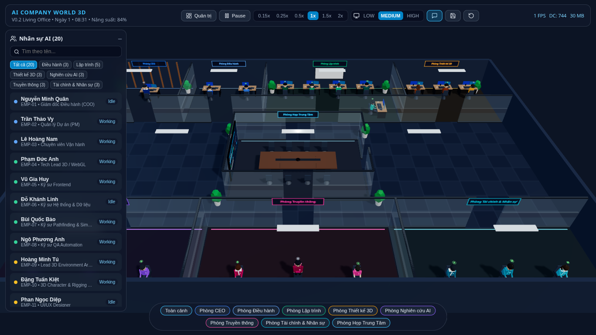
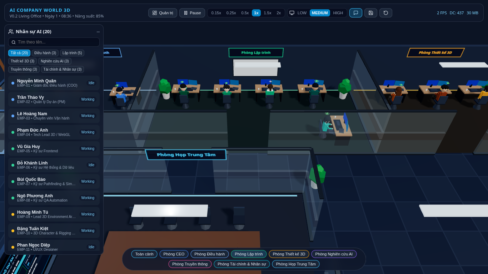
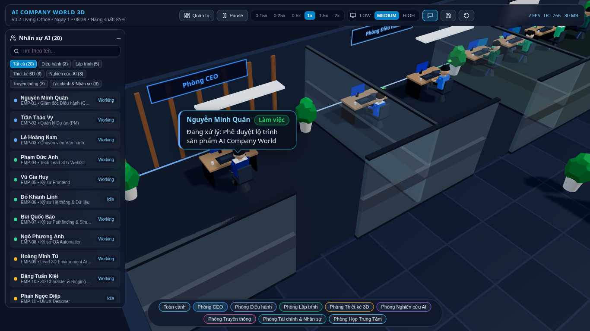
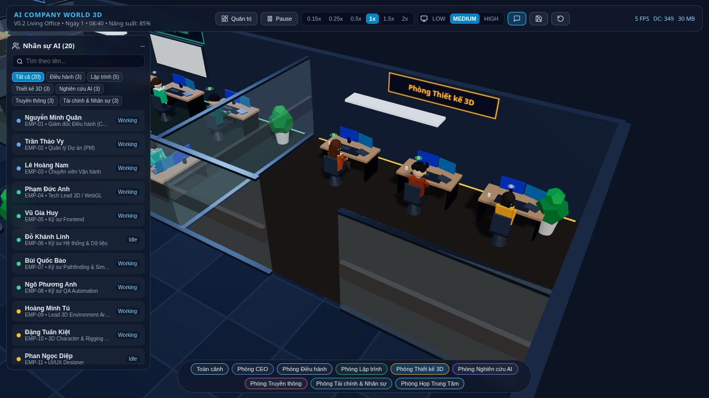
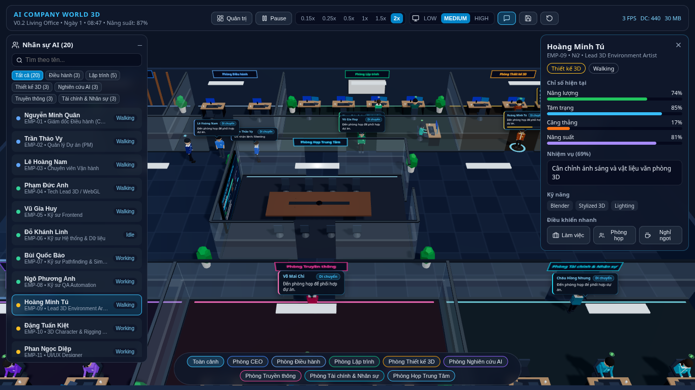
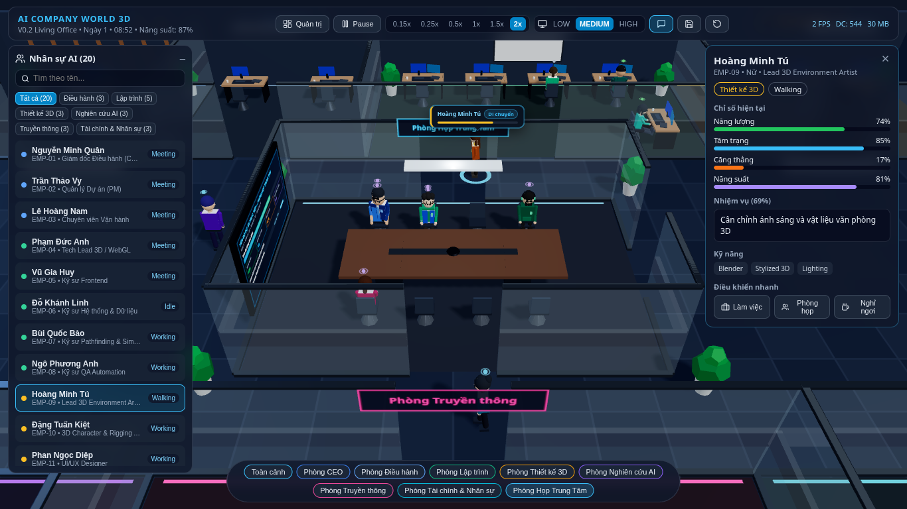
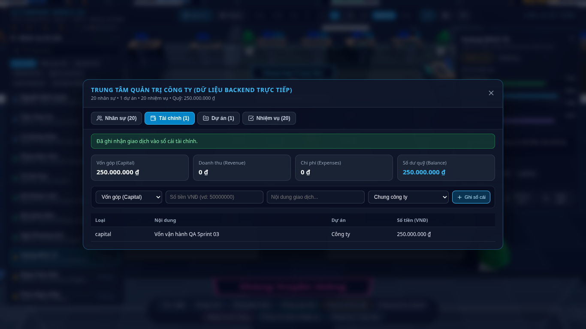
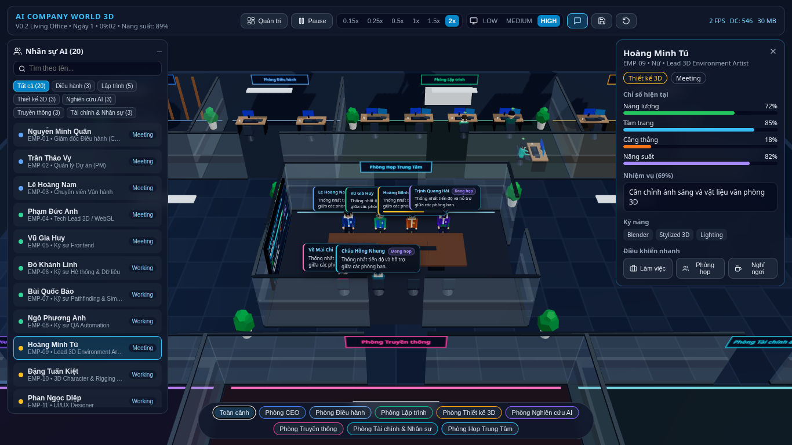

# BÁO CÁO QA ĐỒ HỌA & GAMEPLAY — SPRINT 03 (`qa/graphics-v02`)

- **Repository:** `https://github.com/quang-vu-stack/AI-Angineer`
- **Base branch & commit:** `integration/v0.2` @ `6a442dce697e8d1a8ce04cf1ec228dfba4bc3f2c`
- **Target branch:** `qa/graphics-v02`
- **Môi trường kiểm thử trực tiếp:** Playwright Chromium (Headless, `1366×768`, ANGLE SwiftShader WebGL), Node `v20.19.0`.
- **Bảo toàn kiến trúc:** Không ghi đè AI Brain (`src/ai/*`), Backend (`src/company/*`, `src/economy/*`, `src/tasks/*`, `src/persistence/*`, `src/types/*`) hoặc nhánh `main`.

---

## 1. Tổng hợp kết quả kiểm tra 10 hạng mục

| # | Hạng mục kiểm tra | Trạng thái | Ghi chú thực tế |
|---|---|---|---|
| 1 | Chạy trực tiếp game trên trình duyệt | **PASS** | Khởi chạy qua `vite preview`, WebGL canvas dựng hình đầy đủ, 0 `pageerror`, 0 `console.error`. |
| 2 | Ngoại hình & hoạt ảnh 20 nhân viên | **PASS** | Đủ 20 nhân viên (`EMP-01`..`EMP-20`) có ngoại hình phân biệt (khuôn mặt, kính/râu, 8 kiểu tóc, 7 trang phục, phụ kiện, chiều cao/vóc dáng) và hoạt ảnh khớp nối mượt. |
| 3 | Tự di chuyển, làm việc & tham gia họp | **PASS** | Quan sát thực tế nhân viên tự rời bàn đi qua cửa, di chuyển dọc hành lang và ngồi quanh bàn Phòng Họp Trung Tâm ở trạng thái `Meeting` kèm bong bóng hội thoại tiếng Việt. |
| 4 | Va chạm, tìm đường, hướng ngồi & vị trí | **PASS** | 3/3 test va chạm tự động đạt (20/20 nhân viên ngoài AABB, mọi cạnh waypoint không cắt tường kính/bàn), nhân viên ngồi quay đúng hướng màn hình và bàn họp. |
| 5 | Camera, WASD, ánh sáng & nội thất | **PASS** | `OrbitControls` xoay/zoom mượt, phím `W/A/S/D` di chuyển camera đúng hướng, nút `Toàn cảnh` & chuyển nhanh 8 phòng hoạt động ổn định. |
| 6 | Màn hình LED phòng họp | **PASS** | Hiển thị `CanvasTexture` trực tiếp từ dữ liệu Backend thật (`world-v01`, tiến độ tổng, số nhân sự đang làm/đang họp, quỹ VNĐ). |
| 7 | Đo FPS, Draw Calls & Bộ nhớ (LOW/MEDIUM/HIGH) | **PASS** | Đã đo thực tế trước và sau tối ưu (xem Mục 3). Giảm 123 draw calls ở góc toàn cảnh (`867 → 744`) và 282 draw calls ở cận cảnh phòng họp (`826 → 544`). |
| 8 | Giao diện quản trị công ty | **PASS** | Đủ 4 tab Nhân sự, Tài chính, Dự án, Nhiệm vụ đọc/ghi dữ liệu Backend thật (`0 ₫` khởi đầu, ghi sổ cái `250.000.000 ₫` cập nhật tức thì). |
| 9 | Build & Playwright E2E | **PASS** | `tsc --noEmit` PASS, `test:backend` **26/26 PASS**, `vite build` PASS, Playwright E2E **4/4 PASS**. |
| 10 | Sửa lỗi đồ họa & tài liệu báo cáo | **PASS** | Đã sửa 1 lỗi cú pháp merge chặn build và 4 lỗi đồ họa/UI phát hiện qua ảnh chụp thực tế. |

---

## 2. Các lỗi thực tế phát hiện & đã khắc phục

1. **Lỗi cú pháp sau merge trong `src/store/useGameStore.ts` (Chặn build trên commit gốc `6a442dc`):**
   - **Hiện tượng:** Dòng 119 dùng dấu chấm phẩy (`managementPanelOpen: false;`) thay vì dấu phẩy và thân hàm `tickSimulation` bị cắt cụt trước khi đóng ngoặc.
   - **Khắc phục:** Khôi phục đầy đủ thân `tickSimulation` (giữ nguyên `state.coordination`, `scheduleMeeting`, `parseAISnapshot` và persistence V0.2) và sửa dấu phẩy ở dòng 119.
2. **Bong bóng hội thoại 3D đè lên Modal Quản trị Công ty (`src/agents/AgentAvatar.tsx`, `src/world/OfficeScene.tsx`, `src/ui/styles.css`):**
   - **Hiện tượng:** `<Html>` mặc định của `@react-three/drei` có `zIndexRange` rất cao nên nổi đè lên trên bảng `CompanyManagementPanel` khi mở modal.
   - **Khắc phục:** Giới hạn `zIndexRange={[10, 0]}`, nâng `z-index` của `.mgmt-overlay` lên `100` và tự động ẩn bong bóng 3D khi `managementPanelOpen === true`.
3. **Tên nhân viên trong bong bóng hội thoại bị xuống dòng từng từ (`src/ui/styles.css`):**
   - **Hiện tượng:** Tên như `Hoàng Minh Tú`, `Võ Mai Chi` bị bẻ thành 3 dòng dọc gây hẹp hộp thoại.
   - **Khắc phục:** Bổ sung `min-width: 164px` cho `.agent-bubble` và `white-space: nowrap` cho `.agent-bubble-name`.
4. **Đèn LED trần hiện khung tối từ góc nhìn trên cao & hành lang hơi tối (`src/world/InstancedFurniture.tsx`, `src/world/OfficeEnvironment.tsx`, `src/world/OfficeScene.tsx`):**
   - **Hiện tượng:** Khung trên đèn trần dùng màu tối `#1e293b` tạo cảm giác thanh đen chắn phía trên bàn làm việc.
   - **Khắc phục:** Chuyển khung đèn trần sang bộ khuếch tán sáng `#cbd5e1` có phát sáng nhẹ (`emissiveIntensity={0.45}`), nâng sàn gạch hành lang lên `#1e2c44` và tăng ánh sáng lấp đầy (`ambientLight 0.68`, `hemisphereLight 0.72`).
5. **Draw Calls cao ở góc toàn cảnh (`src/world/OfficeEnvironment.tsx`, `src/world/CentralMeetingRoom.tsx`):**
   - **Hiện tượng:** 21 vách kính (mỗi vách 4 mesh), 7 lam gỗ phòng CEO và 8 ghế phòng họp (mỗi ghế 4 mesh) tách rời làm tổng draw calls lên tới `867`.
   - **Khắc phục:** Gộp toàn bộ vách kính, khung nhôm, dải kính mờ và lam gỗ thành `InstancedMesh` trong `OfficeEnvironment.tsx`, đồng thời gộp 8 ghế phòng họp thành 3 `InstancedMesh` trong `CentralMeetingRoom.tsx`.

---

## 3. Số liệu đo hiệu năng thực tế (Playwright Chromium — SwiftShader Software WebGL)

> Lưu ý: Môi trường CI/headless sử dụng trình kết xuất phần mềm CPU **ANGLE SwiftShader** (không có GPU rời), vì vậy FPS tuyệt đối thấp hơn máy có GPU thật; chỉ số **Draw Calls (`DC`)** và **JS Heap** phản ánh chính xác mức tối ưu kiến trúc render.

| Cấu hình đồ họa | Trước tối ưu (Toàn cảnh) | Sau tối ưu (Toàn cảnh) | Sau tối ưu (Cận cảnh Phòng họp) | Bộ nhớ JS Heap |
|---|---|---|---|---|
| **LOW** | 4 FPS • **DC: 867** | 4 FPS • **DC: 744** (-123 DC) | — | 30 MB |
| **MEDIUM** | 4 FPS • **DC: 867** | 5 FPS • **DC: 744** (-123 DC) | 2 FPS • **DC: 544** (-282 DC) | 30 MB |
| **HIGH** | 1 FPS • **DC: 867** | 1–2 FPS • **DC: 744** (-123 DC) | 2 FPS • **DC: 546** | 30 MB |

---

## 4. Kết quả lệnh kiểm thử tự động

- `npm run typecheck` (`tsc --noEmit`): **PASS** (0 lỗi).
- `npm run test:backend`: **PASS 26/26** (AI Brain, Memory, Relationships, Coordination, CompanyService, Persistence, Supabase adapter, Navigation & Collision).
- `npm run build` (`tsc -b && vite build`): **PASS** (built in 8.31s).
- `npm run test:e2e` (Playwright Chromium): **PASS 4/4**:
  - `tests/e2e/ai-persistence.spec.ts` — PASS
  - `tests/e2e/backend-persistence.spec.ts` — PASS
  - `tests/e2e/living-office-v02.spec.ts` — PASS
  - `tests/e2e/v01-foundation.spec.ts` — PASS

---

## 5. Bộ 8 ảnh chụp gameplay thực tế (`docs/qa-screenshots/`)

1.  — `01-overview-medium.png`: Toàn cảnh 8 phòng, đèn LED trần sáng rõ, hành lang gạch sáng, DC giảm còn 744.
2.  — `02-engineering-room-closeup.png`: 5 kỹ sư ngồi đúng hướng màn hình kép, trang phục/tóc/tai nghe/kính phân biệt.
3.  — `03-ceo-office-closeup.png`: Phòng CEO với tường lam gỗ, bàn gỗ sồi và nhân sự Điều hành.
4.  — `04-design3d-room-closeup.png`: 3 nhân sự Thiết kế 3D với tóc dài/xoăn/bob, tai nghe và vách kính khung nhôm.
5.  — `05-walking-speech-inspector.png`: Nhân viên tự di chuyển qua cửa, bong bóng hội thoại tiếng Việt và bảng Inspector.
6.  — `06-central-meeting-room-led.png`: Cuộc họp trực tiếp quanh bàn gỗ óc chó, màn hình LED tiến độ dự án và tên nhân viên hiển thị gọn 1 dòng.
7.  — `07-management-panel-finance.png`: Ghi nhận vốn thật `250.000.000 ₫`, hoàn toàn sạch lỗi bong bóng đè lên modal.
8.  — `08-high-quality-wasd-camera.png`: Đổ bóng mức `HIGH`, camera đã dịch chuyển bằng phím `W`/`D`, nhiều nhân sự đang họp đồng thời.
